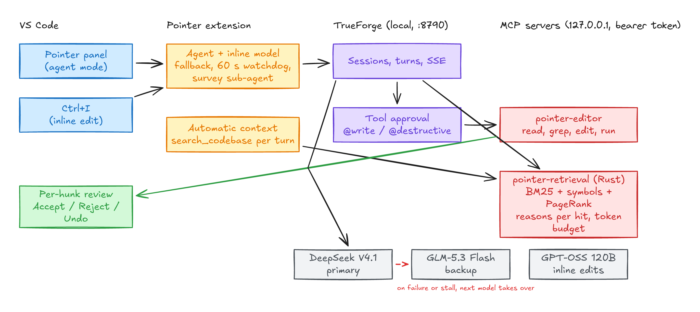

<p align="center"></p>

<h1 align="center">Pointer</h1>

<p align="center">The coding agent that finds the right code before it writes any.</p>

<p align="center">
  <a href="LICENSE"></a>
  
  
  
</p>

---

Pointer is a VS Code agent for repositories too large for any context window.
A Rust engine picks the code that matters and says why; the agent runs on
[TrueForge](https://github.com/truefoundry/trueforge); every change waits in
the editor for you to accept it, hunk by hunk.



## Features

- **Points at the right code.**
  BM25, symbols, file names and a PageRank repo map, fused in Rust. Each hit
  shows its reason. [Puts the right file first 8 times in 10, against 3 for BM25](benchmarks/README.md),
  in 1.5 ms.
- **Inline edit.**
  Select, press <kbd>⌘I</kbd>, describe the change; the diff streams into the
  editor. [An edit that would break the file's syntax is withdrawn](benchmarks/README.md#syntax-gate-for-inline-edits-before-and-after)
  and the next model writes it again.
- **Agent mode.** One request,
  several files, no need to say which. Passed the fixed multi-file task on
  Flask 18 times out of 18, in a median 26 s.
- **Per-hunk review.** Nothing touches disk until you accept it, and
  <kbd>⌘Z</kbd> undoes it.
- **Stop at any time.** Cancelling leaves the workspace clean.
- **Any model, automatic fallback.** If the primary model fails or stalls, the
  backup picks up the conversation. Inline edits can use their own, faster
  model.

## Quick start

```sh
# TrueForge must be allowed to reach loopback (Pointer's tools) and your model host
OUTBOUND_URL_ALLOWED_HOSTS='["127.0.0.1","localhost","your.model.host"]' \
  npx @truefoundry/trueforge@latest --port 8790
# register two model providers (pointer, pointer-backup): copy agent/modelProviders*.example.json,
# fill in, PUT each to localhost:8790/api/v1/settings/model-providers
# (docs/setup.md#2-register-two-model-providers); Pointer loads agent/pointer.agent.json on activation
git clone https://github.com/pointersh/Pointer.git && cd Pointer
rustup target add wasm32-unknown-unknown         # once: the highlighter builds to WebAssembly
npm ci && npm run build && cargo build --release
```

Open the folder in VS Code and press <kbd>F5</kbd>. Full steps:
**[docs/setup.md](docs/setup.md)**.

## Starting point

Forked from [twinny](https://github.com/twinnydotdev/twinny) at `48e5ee5`
(v4.3.21). About 98% of it was removed; Pointer keeps only the editor core
(inline diff, per-hunk review, the panel and workspace tools) and replaces the
agent loop with TrueForge.

## Docs

- [Setup and settings](docs/setup.md)
- [Benchmarks](benchmarks/README.md)
- [`@pointersh/highlight`](crates/pointer-highlight/README.md), our Rust syntax highlighter

## Contact

[@ayuxy027 on X](https://x.com/ayuxy027)

## License

MIT © 2026 Ayush Yadav. Includes code from twinny © 2023 Richard Macarthy.
