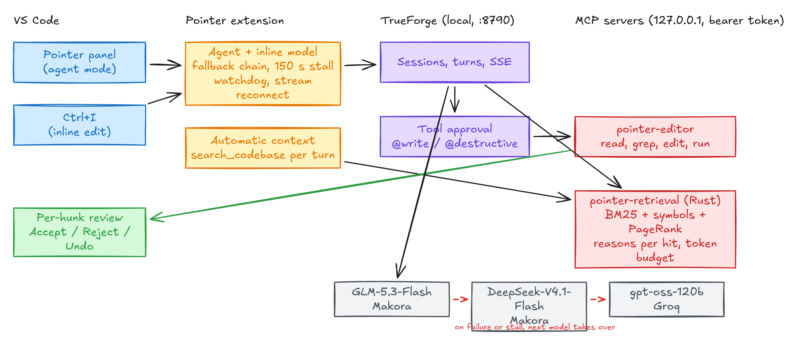

# How Pointer works

## Starting point

**Kept:** the editor side. That is the inline-edit diff engine (a
streamed diff in the editor, per-hunk accept and reject), the webview panel,
the workspace tools (read, list, grep, find, symbols, definition and
references, diagnostics, git, edit, create, move, delete, run) and undo
tracking.

**Removed:**
- the original model layer, provider manager and agent loop;
- the team gateway, P2P pairing and ChatGPT-plan sign-in;
- tab completion, code review, i18n and composer suggestions;
- about 96k lines in all.

**Added:**
- the TrueForge client;
- an editor MCP server;
- a Rust retrieval engine;
- a zero-dependency highlighter (`@pointersh/highlight`).

## Architecture on TrueForge



```
VS Code ── panel / Ctrl+I ──► Agent / TextModel seams ──► TrueForge (local, :8790)
                                                            sessions · turns · SSE
                                                            approvals · subagents · compaction
   MCP (HTTP, 127.0.0.1, bearer token) ◄────────────────────┘
     ├─ pointer-editor     editor tools, writes routed to per-hunk review
     └─ pointer-retrieval  Rust: BM25 + symbols + repo map, reasons per hit
```

- **Client.** Pointer creates sessions and turns through the TrueForge SDK and
  HTTP API, and renders streamed `model.message` deltas in the panel. The
  extension never calls a model provider.
- **Editor capabilities as MCP tools.** The `pointer-editor` server exposes the
  workspace tools with MCP annotations. Read tools carry `readOnlyHint`; write
  tools carry `destructiveHint`, so TrueForge's `@write`/`@destructive`
  approval policy gates them.
- **Approval drives the diff review.**
  1. A write tool pauses the turn (`tool.approval_required`).
  2. Pointer shows the step in the panel.
  3. On allow, it answers `user.tool_approval` and resubscribes to the turn.
  4. The edit opens inline as per-hunk review. Nothing is written silently.
  5. Accepted hunks are applied through `WorkspaceEdit`, so Ctrl+Z undoes them.
- **Cancellation.** Stop aborts the stream and calls `sessions.cancel`. Pending
  approvals are denied, and proposed hunks that were never accepted leave the
  workspace untouched.
- **Harness features used:**
  - dynamic subagents, for scouting files;
  - deferred tool loading, where the agent calls `call_tool` and Pointer
    unwraps the real tool name;
  - context compaction;
  - handling of large tool responses.
- **Agent definition:** [`agent/pointer.agent.json`](../agent/pointer.agent.json).
  It is registered on activation, including only the MCP servers that actually
  started.

## How context is selected

1. **Explicit:** `@file` and `@symbol` mentions are passed to the agent as files
   to read first.
2. **Automatic: `pointer-retrieval`**, a Rust MCP server:
   - code-aware chunks along tree-sitter boundaries;
   - BM25 over identifier-split tokens and paths;
   - a symbol-match boost;
   - a PageRank prior over the definition/reference graph (an Aider-style repo
     map);
   - reciprocal rank fusion of these signals.
3. **Budget:** `search_codebase(query, budget_tokens)` packs the top chunks
   within the budget and reports what it dropped.
4. **Visible reasons:** every chosen chunk carries a computed reason (definition,
   reference count, BM25 terms). The panel shows them as "Pointing at…".
5. **Semantic search (optional, setting `pointer.semanticSearch`):** local
   `bge-small-en-v1.5` through `fastembed`, run in-process on the CPU with no
   API calls. Each passage carries its path and symbol names. Vectors build in
   the background, stored as int8 and persisted in `.pointer/index`, which
   ignores itself; only changed chunks are re-embedded. They join through rank
   fusion, and hits found by it say `semantic 0.59`. Search never waits for the
   model: if it is busy, that query runs on the lexical signals alone. Long
   task-style queries (over 20 terms) skip embeddings, which pull them toward
   loosely related files.

**Measured on Flask 3.1.3:**
- 211 files become 1,376 chunks in about **50 ms**; a query takes about
  **1.5 ms** over MCP.
- With `--semantic`, 1,275 chunks embed in 22–31 s the first time, then are
  reused from disk. A query takes 7–10 ms, or about 2 ms when repeated. On 22
  paraphrased questions that avoid identifiers, MRR rises from 0.46 (lexical
  only) to 0.62. See [benchmarks](../benchmarks/README.md).
- The default budget of 3,000 tokens (about 14k characters) keeps every
  response under TrueForge's 24k-character tool limit, and leaves room for two
  searches and a file read in one parallel step under its 40k combined limit.
- For a multi-file request (add a `flask config` command with a test and
  docs), `cli.py` is the first hit, and `tests/test_cli.py` and `docs/cli.rst`
  are 8th and 10th of the 12 chunks returned: all three files arrive in one
  call.

**Benchmark** ([`benchmarks/`](../benchmarks/README.md), 10 Flask questions with known
answer files):

| Method | Ready | Query | MRR | Answer in top 5 |
|---|---|---|---|---|
| Pointer (Rust: BM25, symbols, file names, PageRank) | 91 ms | 1.6 ms | **0.72** | 8/10 |
| Plain BM25, Node | 112 ms | 0.45 ms | 0.55 | 8/10 |
| Plain BM25, Python | 170 ms | 1.2 ms | 0.55 | 8/10 |
| ripgrep, query words ranked by hits | — | 19 ms | 0.43 | 7/10 |
| git grep, same | — | 115 ms | 0.43 | 7/10 |

Pointer's query time includes the MCP round trip over HTTP; the search itself
takes under 1 ms.

## Model setup

| Role | Model | Where | Price per 1M tokens (in / out) |
|---|---|---|---|
| Primary (`pointer/primary`) | zai-org/GLM-5.3-Flash | Makora inference (OpenAI-compatible), via TrueForge `custom` provider | $0.14 / $0.24 |
| Fallback (`pointer-backup/primary`) | deepseek-ai/DeepSeek-V4.1-Flash | Makora, separate TrueForge provider entry | $0.26 / $1.17 |

- **Switching models:** register any TrueForge provider as `pointer` or
  `pointer-backup`, or set `pointer.models` to any chain of `provider/model`
  names. No code changes are needed.
- **Fallback:** if a turn ends in error, Pointer opens a session on the next
  model, carrying the conversation so far, and says so in the panel. Inline edit
  falls back the same way. This was verified with an invalid primary key: the
  backup answered in about 1.4 s.
- **Reasoning effort:** both models reason at length by default; on Makora a
  coding answer spent 2,000 tokens thinking (11–20 s) before writing anything.
  Pointer sends `reasoning_effort` per model (`low` for GLM-5.3-Flash, `none`
  for DeepSeek-V4.1-Flash), which brings the first answer token to 0.5–1.3 s
  and a full agent turn (read, approved edit) to about 3 s. Override with
  `pointer.reasoningEffort`; measure with `benchmarks/models.mjs`.
